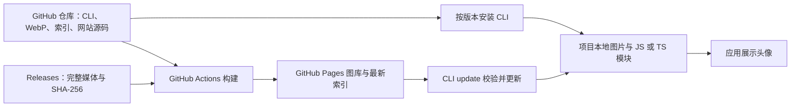

# [draft]Avatar Atlas 安装与发布设计

Avatar Atlas 使用独立 GitHub 仓库 `iambean/avatar-atlas`。仓库提供源码与可直接安装的 CLI，Releases 保存版本安装包和完整媒体，Pages 提供浏览、下载和最新素材索引。图库与乐达心理应用独立。

## 分发与构建

仓库根目录是零运行时依赖的 Node.js 包；`assets/` 包含全部 512px WebP，`catalog.json` 是发布目录的权威索引。`provenance/` 保存创作定义。安装过程没有 npm 会自动识别的 build、prepare 等安装钩子，网站构建命令命名为 build:site，不构建网站，也不下载完整原图。

`media.json` 固定完整媒体的 Release 下载地址和 SHA-256。构建校验归档摘要、文件白名单和 WebP 内容后解压到本地缓存，从源码生成 `site-dist/`。完整媒体包含 1024px PNG、512px WebP、256px 缩略图和几何 SVG；大文件不进入 Git 历史。Releases 另外保存生成时的原始素材归档。

网站支持 `/avatar-atlas/` 项目子路径；页面资源使用相对地址，公开索引中的图片地址携带站点前缀。CLI 允许索引声明的站点子路径，但图片路径仍须与头像 ID 对应，下载后验证 SHA-256。

## 项目内使用

`init` 使用包内素材，安装后应用从项目本地读取头像，无第三方运行时 HTTP 请求。生成模块提供 `avatarUrl()`、`getAvatar()`、`avatars`、`findAvatars()` 和中性默认头像。用户资料保存稳定头像 ID。

`avatar-atlas.config.json` 保存安装目录、公开 URL 前缀、模块路径、分类和更新源；`avatar-atlas.lock.json` 保存工具版本、素材版本和托管文件摘要。它们与安装结果一起提交到接入项目的版本控制。

`add` 扩大分类范围；`update` 获取最新索引，只下载缺失或变化的素材。自定义 CDN 前缀只改变生成的图片地址，CLI 不上传 OSS/CDN。选择任何分类都附带中性默认头像。

## 更新兼容

升级至 CLI 1.3.1 后，配置中精确匹配旧官方 Sites 索引的地址自动迁移到 GitHub Pages；显式指定的 `--source` 和其他自定义源保持用户选择。CLI 1.2.0 可继续使用原站点，迁移不删除旧站。

已有头像 ID 和 WebP 内容保持稳定。下架条目保留本地图片并标记 `retired`，已有引用继续可用，新选择列表隐藏这些条目。索引更新后不由旧安装包静默降级。

写入前校验路径、已有托管文件和下载内容。先暂存，再替换；失败时回滚，无法回滚则保留备份并报告路径。拒绝路径越界和符号链接；未知同名文件不会被覆盖。已修改的托管文件需要 `--force` 才能恢复。

## 发布

1. 运行 CLI 测试、网站构建和检查；核对素材数量、摘要与授权。
2. 提交源码，创建版本标签；创建草稿 Release，上传安装包、素材 ZIP、完整媒体、原始素材和摘要清单。
3. 所有附件就绪后发布 Release。Pages 工作流从对应标签构建并部署；手动运行工作流也可部署选定 ref。
4. 读回 Pages 部署结果，验证公开索引、图片、下载和真实 GitHub 安装流程。

工具版本与素材索引版本分别管理。当前迁移升级工具至 1.3.1，素材仍为 1.1.0。CI 检查每次推送与 PR；Pages 仅由正式 Release 或手动调度触发。旧站点保留，待迁移完成后可单独决定是否关闭。

## 授权

图片使用 CC BY 4.0，CLI 和生成代码使用 MIT。安装器复制授权和署名说明，接入项目负责展示署名并说明修改。素材详情与创作记录保留 AI 生成说明。
